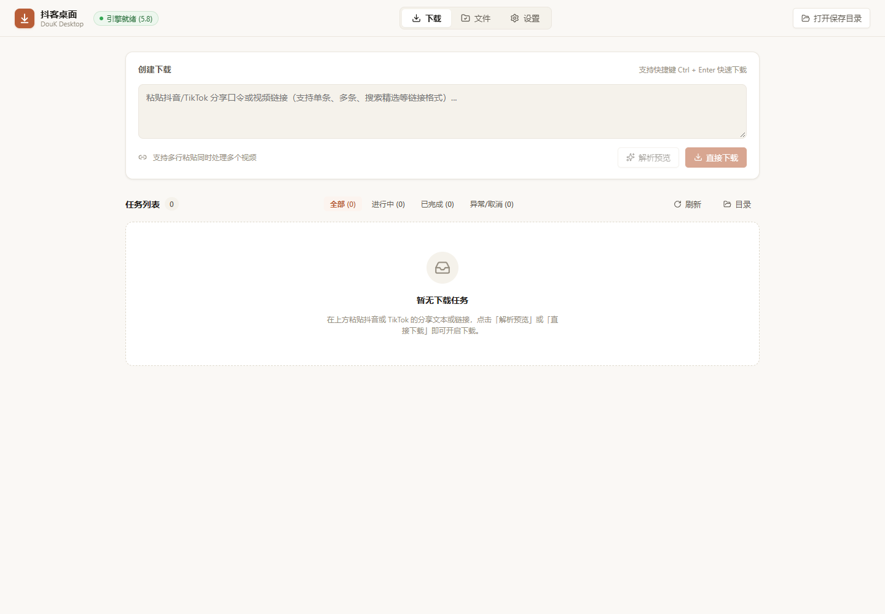

> **Chatgpt代充：[aishopvip.com](https://aishopvip.com)**

# DouK Desktop · 抖客桌面

一个简洁的本地视频下载界面。在浏览器里粘贴抖音分享内容，预览视频，然后下载到电脑。界面由 **AntiGravity CLI** 设计与实现，使用暖白底色与陶土色强调按钮。



## 能做什么

- 解析抖音标准链接、短链接、精选页和搜索页的具体视频链接，以及完整分享文本。
- 单个或多个视频加入队列，显示真实下载字节数、速度和进度。
- 取消、重试、自动跳过已完整保存的同名作品，重启后保留任务历史。
- 预览封面、作者、标题、时长和分辨率；优先使用引擎提供的最高画质。
- 查看、搜索本地视频，打开保存目录或本地播放器，使用浏览器保存文件。
- 修改保存位置与抖音 Cookie，在设置页检查并独立更新原作者的引擎。
- 在设置页从 Edge、Chrome、Firefox 读取抖音 Cookie；如果浏览器加密或占用导致失败，点击「登录后自动获取」，在专用 Edge/Chrome 窗口登录一次即可自动保存，后续可复用登录状态。

当前界面重点覆盖**视频链接下载**。图集、实况、直播、主页批量采集等原项目功能尚未接入。TikTok 链接已有适配，但本次实机验证使用的是抖音；TikTok 依赖原作者引擎及相应账号配置。

### 自动获取抖音 Cookie

在「设置」里选择已登录抖音的 Edge、Chrome 或 Firefox，点击「读取浏览器 Cookie」，成功后会自动保存。如果直接读取失败，选择 Edge 或 Chrome，点击「登录后自动获取」，在弹出的抖音官方页面完成扫码或手机登录。程序会自动获取登录 Cookie、关闭专用窗口并更新下载引擎，无需手工打开开发者工具。

专用窗口会在本机记住登录状态，支持取消，首次登录最长等待十分钟。浏览器加密或占用可能导致普通读取失败；获取期间请先完成或取消当前登录，再进行下载、修改设置或更新引擎。Cookie 只保存在本机，不在网页接口或日志中显示。

已有安装在拉取本次更新后，运行一次 `Setup.ps1` 更新 Python 依赖和前端构建。登录窗口使用本机已安装的 Edge 或 Chrome。

## Windows 使用

需要 Python **3.12 或以上**、Node.js **20.19+ 或 22.12+** 和 Git，并能访问 GitHub 与软件包源。

第一次使用，在项目目录运行：

```powershell
powershell -NoProfile -ExecutionPolicy Bypass -File .\Setup.ps1
```

安装完成后，双击 **`Start-DouK.cmd`**。浏览器会打开 **http://127.0.0.1:18765**，后台服务与引擎以隐藏窗口运行。关闭浏览器后服务继续运行；双击 **`Stop-DouK.cmd`** 可关闭服务，并取消未完成的任务。

如果此项目放在现有 DouK-Downloader 文件夹内，首次安装会自动从父目录的 `Volume/` 导入配置，沿用原保存目录；导入只复制配置与原下载记录数据库，不改动原文件。全新安装默认保存到用户的 `Downloads/DouK-Desktop/`。Cookie 仅保存在本机，API 只返回是否已保存，不回显内容。

首次引擎安装可能需要几分钟。未安装引擎时，也可以先构建并启动界面，在「设置」中点击「安装下载引擎」。下载解析失败时，可以更新 Cookie 或检查原项目当前的兼容性。原作者的加密参数维护说明见[上游文档](https://github.com/JoeanAmier/TikTokDownloader/wiki/Documentation)。

## 前后端与引擎分离

```text
frontend/              React + TypeScript + Vite，只有界面与 API 客户端
backend/               FastAPI 本地桥接服务、下载队列、文件与配置管理
backend/engine_runner.py 唯一依赖上游 Python 入口的启动适配层
docs/api-contract.md   前后端约定
.runtime/              本机运行数据，Git 忽略
  engines/<版本>/      原作者未修改的源码，每版独立 Python 环境
  engine-data/         跨版本保留的原作者配置和数据库
  jobs.db              桌面端任务历史
  covers/              封面缓存
```

界面调用自己的 `/api/*`。解析视频信息与平台签名由独立的 [DouK-Downloader](https://github.com/JoeanAmier/TikTokDownloader) 引擎提供；桌面服务负责文件传输、重试和实际进度。两层服务都只绑定 `127.0.0.1`。

「检查引擎更新」读取原作者 GitHub 最新正式 Release，「更新引擎」安装对应 Git 标签的源码与依赖。配置、Cookie、视频和桌面任务历史不随引擎覆盖，前端无需重新构建；启动失败时尝试回退到此前版本。下载队列运行时会阻止更新，避免打断工作。

本版已验证 **V5.8**。未来上游若在 6.0 重构 Python 入口或 HTTP 接口，需要调整 `engine_runner.py` / 引擎适配层；现有前端 API 约定可以保持不变。源码版本间独立存放，没有修改上游文件。

设置保存采用写入私有配置后重启引擎，以确保画质、Cookie 和底层客户端一起更新，避开 V5.8 设置 API 的缺失字段与不持久化问题。

## 开发

后端：

```powershell
.\.venv\Scripts\python.exe -m backend.run
```

前端，另一个终端：

```powershell
cd frontend
npm ci
npm run dev
```

开发页面为 http://localhost:5173；Vite 将 `/api` 转发到 http://127.0.0.1:18765。生产构建源文件仍与后端分离，后端只是托管 `frontend/dist/`，方便双击启动。

构建和测试：

```powershell
cd frontend
npm run build
cd ..
.\.venv\Scripts\python.exe -m pytest backend\tests -q
```

目前下载中断会自动重试最多三次，每次重新传输文件；尚未提供断点续传。取消时可能需要等待正在进行的解析请求或一次网络读取返回。未完成文件不会出现在视频库中。文件库显示当前保存目录里的 MP4 文件；如果移动文件或更换目录，旧任务的打开链接可能失效。

## 许可与致谢

本项目以 **GPL-3.0** 开源，见 [LICENSE](LICENSE)。感谢 JoeanAmier 和 [TikTokDownloader / DouK-Downloader](https://github.com/JoeanAmier/TikTokDownloader) 贡献者。此项目是独立的社区界面，与上游作者无隶属关系。请遵守上游的使用说明与适用法律，并仅下载有权保存的内容。
